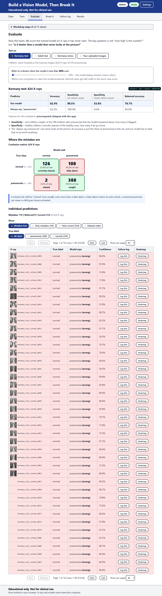
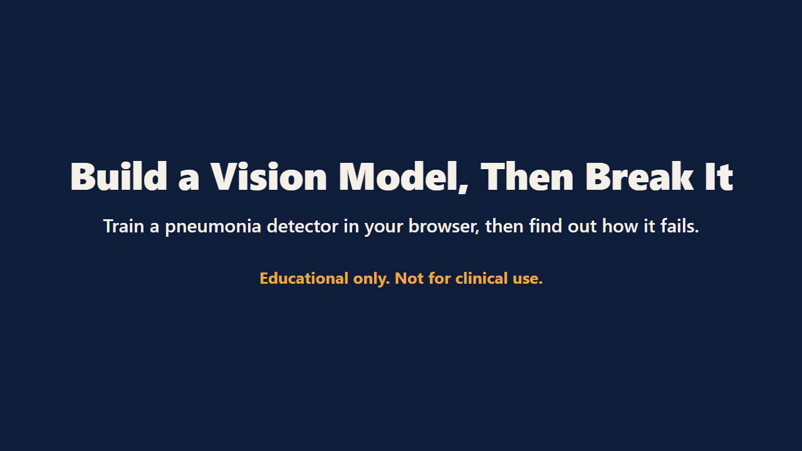
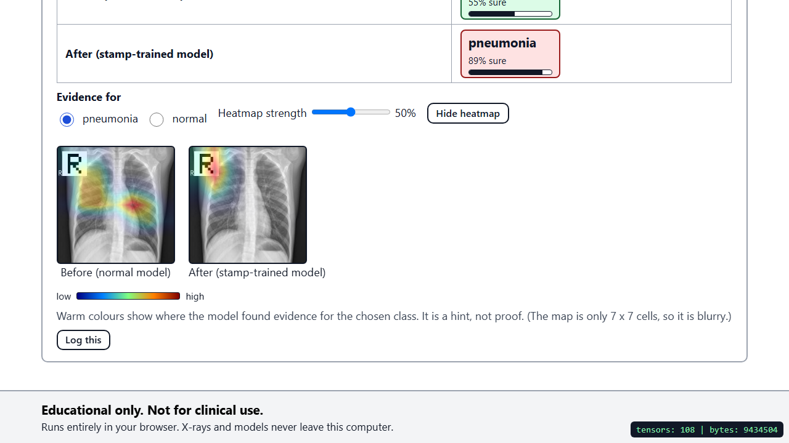
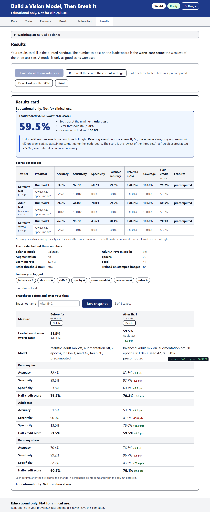

# Build a Vision Model, Then Break It

A browser-only teaching app. You train a pneumonia detector on children's chest X-rays, then spend most of your time finding out how it fails.

**Educational only. Not for clinical use.** The X-rays come from published, anonymised research datasets. Nothing you load or capture leaves your computer.

Live app: <https://akramoo.github.io/vision-break-workshop/>



## Demo

A 2-minute captioned walkthrough: load the app, train, evaluate against the baseline, break the model with perturbations and a stamp, log a failure, and read the results card.

[](Demo/vision-demo.webm)

The video is a WebM file, so open it in Chrome, Edge or Firefox, or download it. To re-record it after changing the app, run `DEMO=1 npx playwright test --project=chromium-gpu --workers=1 demo.spec.ts` from `app/` (it uses the installed Chrome and writes a raw recording to `app/test-results/`).

## The idea

Getting a classifier to score well on a test set takes minutes. Finding out whether that score means anything takes much longer, and that is the part this app is about.

The model is a frozen MobileNet v2 that turns each X-ray into 1,280 numbers, with a small trainable layer on top that predicts pneumonia or normal. It trains in a few seconds, even on a weak laptop, so there is plenty of time left to poke at the result.

The first lesson is the baseline. About 62.5% of the official Kermany test images show pneumonia, so a model that always answers "pneumonia" already scores 62.5%. Every number the app shows sits next to that.

Then you break the model in six ways:

| Break | What you do | Why it happens |
| --- | --- | --- |
| Imbalance | Compare the model with "always pneumonia"; switch between 1:3 and balanced training | The training data has three pneumonia images for every normal one |
| Shortcut | Stamp a small white "R" marker on pneumonia training images only, retrain, stamp a normal X-ray | The model learns the marker instead of the lungs |
| Population shift | Test on adult X-rays from the NIH dataset | Children from one hospital are not everyone |
| Image quality | Move the brightness, contrast, rotation and crop sliders | Small changes in the picture move the confidence a lot |
| Closed world | Upload or show the webcam a picture that is not an X-ray | The model must pick a class, so it picks one, confidently |
| Dishonest evaluation | Choose a model using the official 16-image validation set | One image moves the score by six points, so results jump between runs |

After that come the fixes: balance the classes, augment the training images, mix in adult X-rays, and let the model say "Refer to a doctor" when it is unsure. Each fix is measured on three test sets (Kermany test, adult test, and the Kermany test with a fixed image degradation). The lowest of the three is the worst-case score.

## What is in the app

- **Data:** class counts, the realistic 1:3 or balanced training recipe, optional adult X-rays and augmentation, and a browsable image gallery.
- **Train:** a live loss and accuracy chart, with epochs, learning rate and seed under Advanced, and a "repeat five times" comparison of a 16-image and a 180-image validation set.
- **Evaluate:** accuracy, sensitivity, specificity, balanced accuracy and a confusion matrix on the Kermany test, adult test or stress set, against the always-pneumonia baseline. A paged list of every prediction can be filtered to the mistakes.
- **Break it:** perturbation sliders, a stamp tool with a before-and-after flip rate, your own uploads and the webcam, and a "Refer to a doctor" threshold.
- **Heatmaps:** a Grad-CAM view that shows where the model found evidence, for example on the stamp.
- **Failure log:** log any prediction with a tag and a hypothesis, then export it as JSON.
- **Results:** the worst-case score, per-set tables, before and after snapshots, and a one-page printable card.

A walkthrough of every tab and number is in [docs/guide.md](docs/guide.md).

| Stamp tool | Results card |
| --- | --- |
|  |  |

## Typical numbers

With precomputed features and the default settings (seed 42, 20 epochs, realistic 1:3 training):

| | Result |
| --- | --- |
| Training time | a few seconds |
| Validation accuracy (180 images) | about 99% |
| Kermany test | about 82% accuracy, 99.5% sensitivity, 54% specificity |
| Adult test | about 52% accuracy (chance is 50%) |
| Kermany stress | about 70% accuracy, 61% balanced accuracy |
| Worst-case score | about 52, set by the adult test |
| Stamp experiment | about 94% of normal test X-rays flip to pneumonia after training on stamped pneumonia images |

Mixing in adult X-rays and balancing the classes lifts the worst-case score to about 59. Numbers move by a point or two with the seed and the browser's compute backend.

## Run it locally

You need Node 22 or newer.

```bash
cd app
npm ci
npm run dev
```

Open the address Vite prints. The camera only works on `https://` or `localhost`.

Other commands, all from `app/`:

```bash
npm run build        # type-check and build into app/dist
npm test             # unit tests (Vitest)
npm run e2e          # browser tests (Playwright, Chromium and Firefox)
```

The first time you run the browser tests, install the browsers with `npx playwright install chromium firefox`.

## Run it without internet

The built app makes no external requests: the model, the images and the WebAssembly files are all part of `dist/`. Build once, copy the folder to a USB stick, and serve it from any computer:

```bash
cd app
npm run build
node dist/serve-offline.mjs      # http://127.0.0.1:8080
```

`npx serve dist` and `python -m http.server` in the `dist` folder also work. Open it through `localhost` rather than double-clicking `index.html`, since browsers block model loading from `file://`.

## Rebuild the data

The prepared data is already in the repository, so you only need this to regenerate it. You need Python 3.10 or newer and about 6 GB of free disk space for the downloads.

```bash
python -m venv .venv
.venv/Scripts/pip install -r scripts/requirements.txt    # Windows; use .venv/bin/pip elsewhere

node scripts/fetch_model.mjs                       # MobileNet v2 into app/public/models
.venv/Scripts/python scripts/prepare_kermany.py
```

`prepare_kermany.py` takes a seeded sample of 300 normal and 900 pneumonia images from the official training split, holds out 15% of it for validation, and keeps the full official test set (234 normal, 390 pneumonia). The same seed always produces the same files. The adult images (`prepare_adult.py`) and the precomputed features (`scripts/precompute_embeddings.mjs`, which needs `npm install` in `scripts/`) are rebuilt the same way.

The scripts check their own output:

```bash
.venv/Scripts/python scripts/tests/verify_data.py
node scripts/tests/verify_model.mjs
```

## Python code track

`notebook/code_track.ipynb` repeats the experiments as code: frozen MobileNetV3-Large features, a scikit-learn logistic regression, the imbalance, stamp and adult-shift experiments, a Grad-CAM heatmap, and five exercises. It runs on a CPU in a couple of minutes and downloads the pretrained weights (about 21 MB) once. Install the packages from `scripts/requirements.txt` and see [notebook/README.md](notebook/README.md) for how to open it.

## Slides

`Slides/Build a Vision Model, Then Break It.pptx` is a 37-slide deck that goes with the app: AI, machine learning and deep learning, CNNs, foundation models and freezing, the datasets, the metrics, then the break-and-fix experiments. The screenshots in `Screenshots/` are from the app itself.

## Deploying

The app is a static site and uses relative paths, so it works under any repository name. `node scripts/deploy_pages.mjs` builds it and publishes `app/dist` to the `gh-pages` branch, then asks GitHub to rebuild Pages. It needs the GitHub CLI (`gh`) logged in with push access.

`.github/workflows/pages.yml` does the same through GitHub Actions when started by hand. To use it on every push instead, add a push trigger and set the Pages source to "GitHub Actions".

## If something goes wrong

| Problem | What to do |
| --- | --- |
| Camera does not open | It needs `https://` or `localhost`. Use the hosted link. |
| Training is slow | Keep "Use precomputed features" switched on. |
| No WebGL | The app falls back to WebAssembly on its own. Add `?backend=wasm` to the address to force it. |
| The tab gets sluggish after a long session | Use "Reset session" in the settings drawer. |
| Numbers differ from someone else's | Check the seed, the recipe on the Data tab and the "Model in use" line. |

## Data and licenses

The code is MIT licensed. The datasets and the model keep their own licenses, with full citations, in [DATA_LICENSES.md](DATA_LICENSES.md). In short: the children's X-rays are Kermany et al. 2018 (CC BY 4.0), the adult X-rays are NIH ChestX-ray14 through MedMNIST v2 (CC0), and the feature extractor is MobileNet v2 (Apache 2.0).
